# E-Commerce DevOps Project

An end-to-end E-Commerce application integrated with modern DevOps practices, including containerization, CI/CD automation, Kubernetes deployment, Infrastructure as Code, and monitoring.

This project demonstrates how to develop, containerize, deploy, and monitor a full-stack web application using industry-relevant DevOps tools and cloud infrastructure.

## Project Overview

The application consists of a React frontend, a Node.js and Express backend, and a PostgreSQL database. Docker is used to containerize the application components, while Jenkins automates the CI/CD workflow.

The deployment environment uses Kubernetes on Amazon EKS, with Terraform for infrastructure provisioning. Prometheus and Grafana are used for monitoring and visualization.

**Project Repository:** [ecommerce-thedev](https://github.com/yousefibrahim14/ecommerce-thedev)

**Project Status:** The application and deployment workflow were tested during the project. The AWS lab infrastructure has since been cleaned up and is not currently running.

---

## 🏗️ System Architecture

The following diagram illustrates the main components of the E-Commerce DevOps project, including the application, CI/CD pipeline, AWS infrastructure, and monitoring stack.

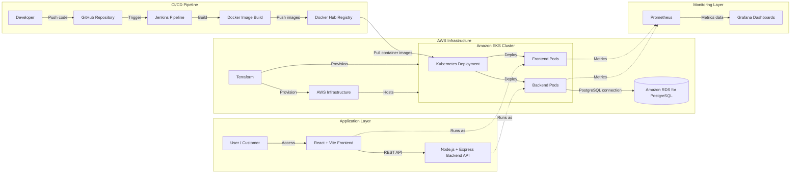

---

## 🛠️ Technology Stack

| Category | Technology | Purpose |
|---|---|---|
| Frontend | React, Vite | Building the user interface |
| Backend | Node.js, Express.js | Implementing REST APIs and business logic |
| Database | PostgreSQL, Amazon RDS for PostgreSQL | Storing application data |
| Containerization | Docker, Docker Compose | Packaging and running application services |
| Version Control | Git, GitHub | Source code management and collaboration |
| CI/CD | Jenkins | Automating the build and deployment workflow |
| Container Registry | Docker Hub | Storing and distributing Docker images |
| Orchestration | Kubernetes, Amazon EKS | Deploying and managing application containers |
| Infrastructure as Code | Terraform | Provisioning AWS infrastructure |
| Monitoring | Prometheus, Grafana | Collecting metrics and visualizing monitoring data |

---

## ✨ Application Features

### Product and Category Management
- Retrieve and display products from the backend API.
- Organize products by categories.
- Store product and category data in PostgreSQL.

### Authentication and Authorization
- User registration and login.
- Password hashing using bcrypt.
- JWT-based authentication for protected API endpoints.

### Shopping and Orders
- Add products to the shopping cart.
- Review cart items and proceed to checkout.
- Place orders and view order history.

### Full-Stack Integration
- React frontend integrated with the Node.js and Express backend.
- REST API communication between frontend and backend.
- PostgreSQL database integration for persistent application data.

---

## 🔄 CI/CD Pipeline

The project uses Jenkins to automate backend testing, Docker image building, image publishing, and Kubernetes deployment.

### Pipeline Stages

1. **Checkout:** Retrieves the project source code from the configured SCM repository.
2. **Project Validation:** Checks that required application files, tests, Dockerfiles, and Kubernetes manifests exist.
3. **Backend Testing:** Installs backend dependencies with `npm ci` and runs automated tests using `npm test`.
4. **EKS Access Validation:** Verifies AWS authentication, updates the EKS kubeconfig, and checks Kubernetes nodes and application deployments.
5. **Build Docker Images:** Builds separate Docker images for the backend and frontend.
6. **Push Images to Docker Hub:** Publishes versioned images using the Jenkins build number and also updates the `latest` tags.
7. **Deploy to Amazon EKS:** Updates the backend and frontend Kubernetes Deployments to use the newly published images.
8. **Deployment Verification:** Waits for both Deployments to complete their rollout and displays the resulting Deployment and Pod status.

### CI/CD Workflow

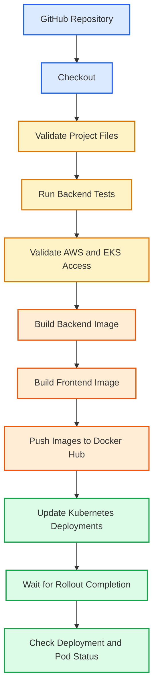

### Image Tagging

Docker images are tagged with the Jenkins build number to identify individual pipeline builds. The pipeline also updates the `latest` tag for both application components.

- `ecommerce-backend:<BUILD_NUMBER>`
- `ecommerce-frontend:<BUILD_NUMBER>`
- `ecommerce-backend:latest`
- `ecommerce-frontend:latest`

### Credentials and Deployment Configuration

Jenkins uses configured credentials for Docker Hub authentication and AWS access. Kubernetes deployment commands target the `ecommerce` namespace in the configured Amazon EKS cluster.

Sensitive credentials are stored in Jenkins Credentials rather than hardcoded into the pipeline script.

---

## ☁️ AWS Infrastructure & Terraform

Terraform is used to define the AWS infrastructure required to support the E-Commerce application and its Kubernetes deployment.

### Infrastructure Components

| Component | Purpose |
|---|---|
| Amazon VPC | Provides network isolation for the AWS environment |
| Public and Private Subnets | Organize resources into public and private network segments |
| Internet Gateway | Provides internet connectivity for applicable public resources |
| NAT Gateway and Elastic IP | Support outbound internet access from private subnets |
| Route Tables | Control traffic routing between network destinations |
| Amazon EKS | Provides the managed Kubernetes control plane |
| EKS Managed Node Group | Provides worker nodes for running application workloads |
| Amazon RDS for PostgreSQL | Provides a managed relational database outside the Kubernetes cluster |
| Security Groups | Control permitted network traffic |
| IAM Roles and Policies | Provide permissions for EKS and related AWS components |
| OIDC Provider | Supports IAM integration for Kubernetes service accounts and AWS services |
| AWS Load Balancer Controller IAM Resources | Define the IAM resources associated with load balancer controller integration |

### Infrastructure as Code Workflow

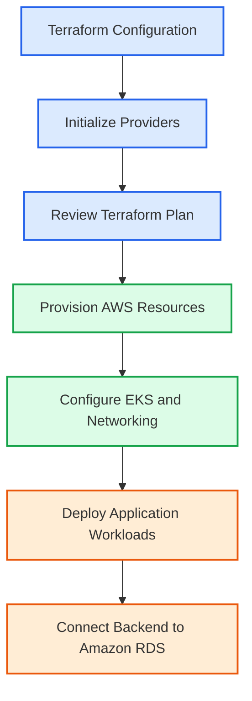

### Terraform Configuration

The Terraform configuration is organized into multiple files:

- `main.tf` — VPC, networking, security groups, and RDS resources.
- `eks.tf` — EKS cluster, managed node group, IAM roles, and policy attachments.
- `alb-controller.tf` — IAM and OIDC resources associated with AWS Load Balancer Controller integration.
- `variables.tf` — Input variables.
- `outputs.tf` — Terraform outputs.
- `versions.tf` — Terraform and provider configuration.

### Infrastructure Status

The AWS lab infrastructure was provisioned and used during project implementation. The lab resources have since been cleaned up and are not currently running.

The Terraform configuration is retained in the repository for infrastructure review and future lab deployments. Review the Terraform plan and estimated AWS costs before provisioning resources again.

---

## ☸️ Kubernetes Deployment

Kubernetes is used to deploy and manage the frontend and backend application components in Amazon EKS.

### Deployment Components

- **Amazon EKS:** Managed Kubernetes environment used for the application deployment.
- **Namespace:** Application resources are deployed in the `ecommerce` namespace.
- **Backend Deployment:** Runs the Node.js and Express REST API.
- **Frontend Deployment:** Runs the React and Vite frontend.
- **Container Images:** Backend and frontend images are published to Docker Hub and referenced by the Kubernetes Deployments.
- **Amazon RDS:** The backend connects to Amazon RDS for PostgreSQL, which runs separately from the Kubernetes cluster.

### Deployment Workflow

The Jenkins pipeline updates the container images used by the Kubernetes Deployments and waits for both rollouts to complete.

```bash
kubectl get deployments,pods -n ecommerce
```

To inspect the rollout status of the backend:

```bash
kubectl rollout status deployment/ecommerce-backend -n ecommerce
```

To inspect the rollout status of the frontend:

```bash
kubectl rollout status deployment/ecommerce-frontend -n ecommerce
```

### Kubernetes Manifests

The repository contains Kubernetes deployment manifests under the `k8s/` directory, including:

- `k8s/backend-deployment.yaml`
- `k8s/frontend-deployment.yaml`

These manifests define the application workloads used by the deployment workflow.

### Deployment Status

The application was deployed and tested on Amazon EKS during the project. The AWS lab infrastructure has since been cleaned up, so the cluster and its workloads are not currently running.

---

## 📊 Monitoring with Prometheus & Grafana

Prometheus and Grafana were used to monitor the Kubernetes environment and visualize metrics during the project.

### Prometheus
- Collects metrics from configured monitoring targets.
- Provides a query interface for inspecting collected metrics.
- Helps monitor Kubernetes workloads and resource states.

### Grafana
- Provides dashboards for visualizing monitoring data.
- Uses Prometheus as a data source to display metrics.
- Helps make workload and infrastructure metrics easier to interpret.

### Monitoring Workflow

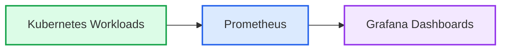

### Monitoring Status

Prometheus targets and metric queries were verified during the project. The AWS lab infrastructure has since been cleaned up, so the monitoring environment is not currently running.

---

## 📸 Screenshots

The following screenshots will showcase the application, CI/CD pipeline, Kubernetes deployment, and monitoring environment.

| Component | Screenshot |
|---|---|
| Products Page | `docs/screenshots/products-page.png` |
| Authentication | `docs/screenshots/authentication.png` |
| Order Workflow | `docs/screenshots/order-workflow.png` |
| Jenkins Pipeline | `docs/screenshots/jenkins-pipeline.png` |
| Kubernetes Workloads | `docs/screenshots/kubernetes-workloads.png` |
| Prometheus Targets | `docs/screenshots/prometheus-targets.png` |
| Grafana Dashboard | `docs/screenshots/grafana-dashboard.png` |
| AWS Architecture | `docs/screenshots/aws-eks-architecture.png` |

Add the actual project screenshots to the `docs/screenshots/` directory before using the image references below.

### Application

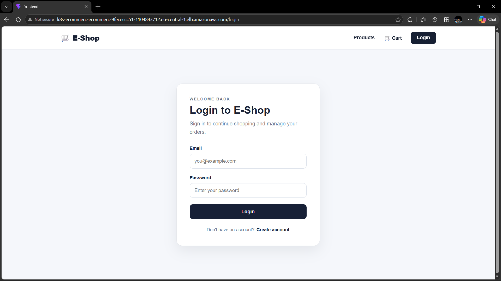

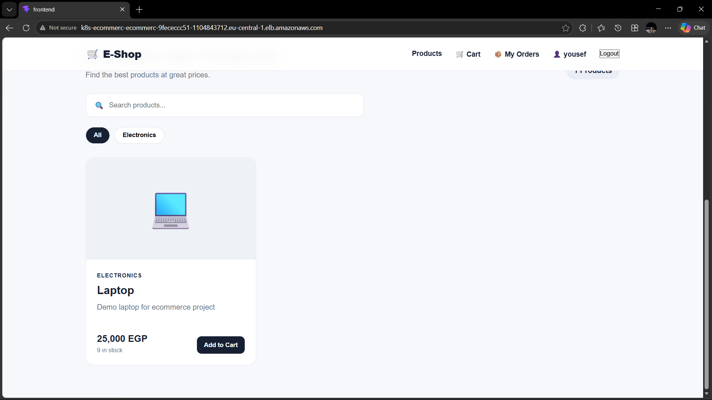

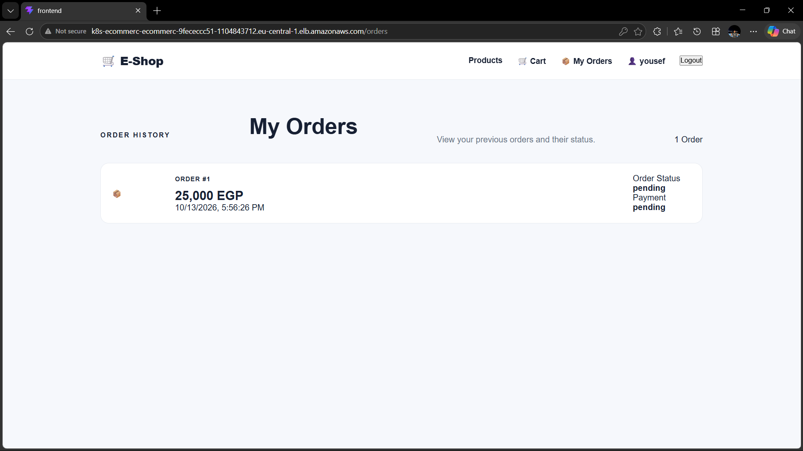

### CI/CD and Kubernetes

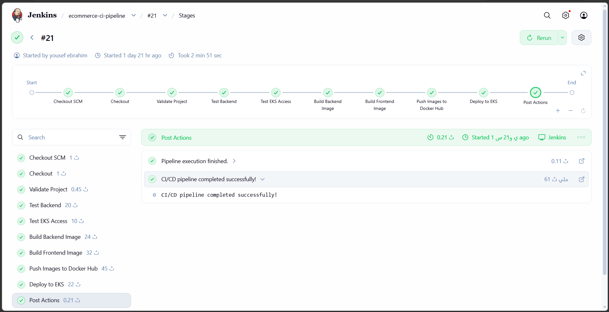

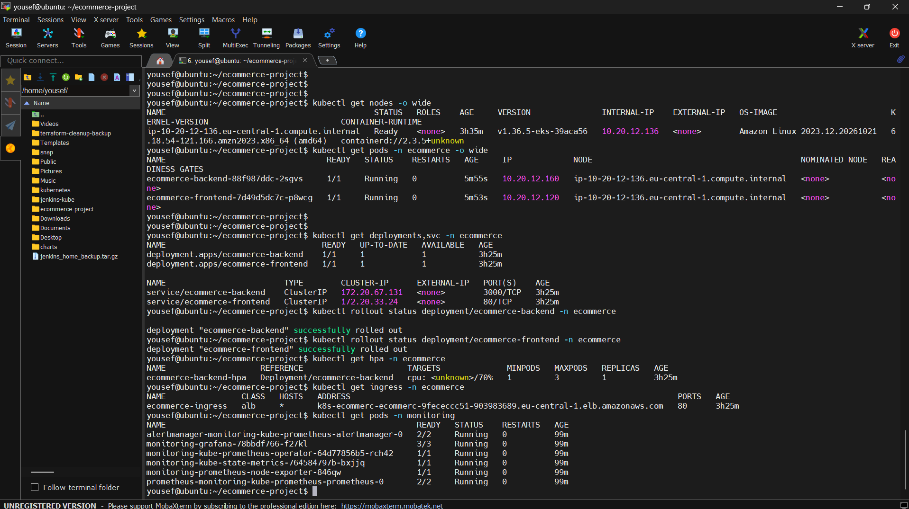

### Monitoring

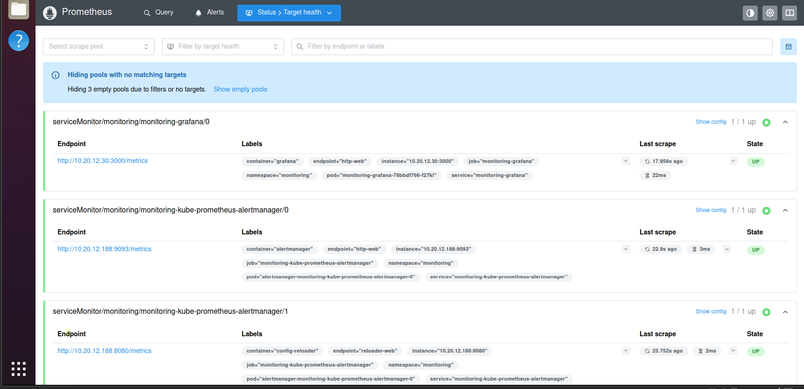

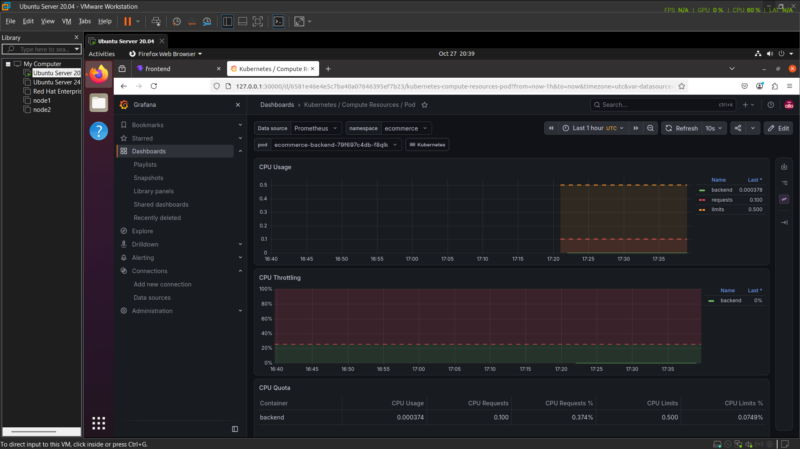


